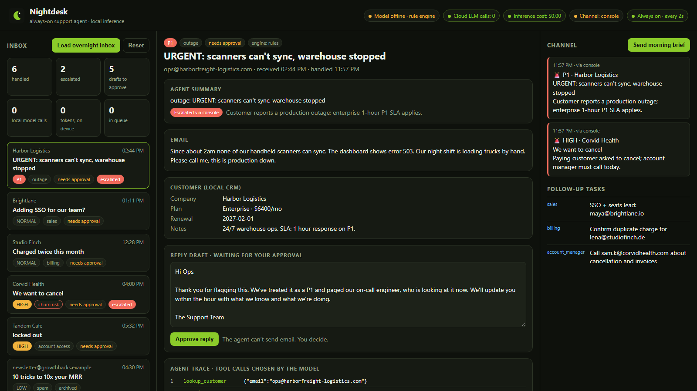
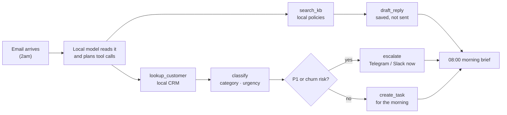
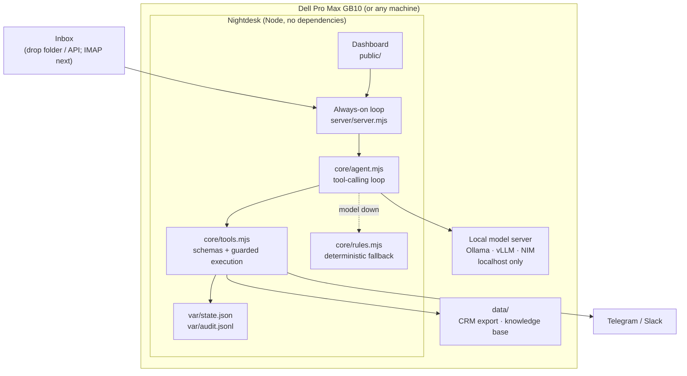
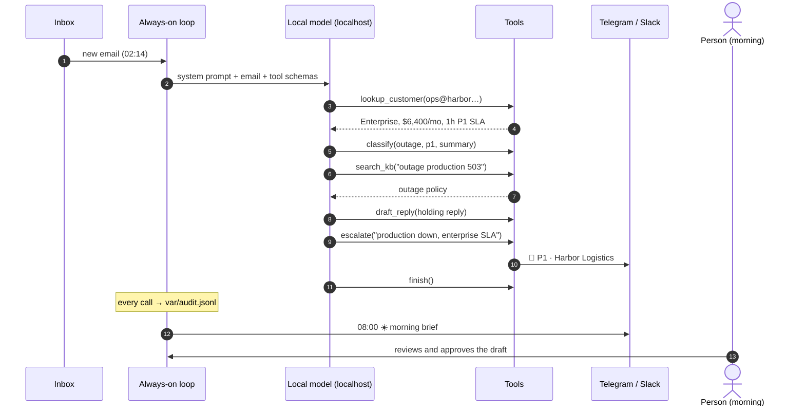

# Nightdesk

**The support agent that works the night shift. On your own hardware.**

Nightdesk is an always-on agent for a company's support inbox. Overnight it reads every email, looks the sender up in the CRM, finds the policy that applies in the knowledge base, and drafts a grounded reply for a person to approve in the morning. When something can't wait, like a production outage at an enterprise customer or a paying customer asking to cancel, it pages the on-call channel in **Telegram or Slack** straight away. At 08:00 it posts a **morning brief**: what came in, what was escalated, which revenue is at risk, and who owns each follow-up.

Every reasoning step and tool choice is made by a **local model** behind an OpenAI-compatible server (Ollama, vLLM or NIM). The code refuses any model endpoint that isn't `localhost`, so customer email never reaches a cloud LLM. It is built to run 24/7 on a **Dell Pro Max with NVIDIA GB10**.

Built by **Paras Adlakha** and **Harshita Adlakha** for the **Dell × NVIDIA AI Hackathon**, San Francisco, October 25, 2026.

**▶️ [Try it live in your browser](https://parasadlakha.github.io/nightdesk/app/)** · **🎬 [Narrated 2-minute demo](docs/video/Nightdesk-demo-2min.mp4)** · [3-minute pitch video](docs/video/Nightdesk-pitch-3min.mp4) · **📑 [Slides (PDF)](docs/slides/Nightdesk-slides.pdf)** · [PowerPoint](docs/slides/Nightdesk-slides.pptx) · [Project page](https://parasadlakha.github.io/nightdesk/)



*An outage at Harbor Logistics, an enterprise account on a 1-hour SLA: classified P1, escalated, and a reply drafted from the outage policy. The trace below the draft lists every tool call the agent made. (Screenshot taken with the rule engine; the engine tag on each email says which one handled it.)*

**Contents:** [The hackathon](#the-hackathon) · [The problem](#the-problem) · [What Nightdesk does](#what-nightdesk-does) · [Architecture](#architecture) · [How one email is handled](#how-one-email-is-handled) · [Local-first by construction](#local-first-by-construction) · [Guardrails](#guardrails) · [Run it yourself](#run-it-yourself) · [Running on the Dell Pro Max GB10](#running-on-the-dell-pro-max-gb10) · [Repository layout](#repository-layout) · [What we learned](#what-we-learned) · [Limitations and roadmap](#limitations-and-roadmap) · [Team](#team)

---

## The hackathon

| | |
|---|---|
| **Event** | Dell × NVIDIA AI Hackathon ([Luma page](https://luma.com/builde-ixyz)) |
| **Date and place** | Sunday, October 25, 2026 · Frontier Tower, 995 Market St, San Francisco |
| **Brief** | Build an always-on autonomous agent for work (inbox triage, CRM cleanup, incident monitoring, overnight research, private-document Q&A) that runs locally and is useful enough that a company would pay for it |
| **Hardware** | Dell Pro Max with GB10 |
| **Stack** | NemoClaw / OpenClaw / OpenShell; a messaging channel (Slack, Discord or Telegram) |
| **Hard rule** | All inference local. No remote LLM calls at runtime |
| **Judged on** | Technical execution, business value, local-first design, demo quality |

### What the brief asked for, and where it is in Nightdesk

| Brief | Nightdesk |
|---|---|
| Always-on autonomous agent | A loop polls the inbox every `POLL_SECONDS`. A systemd unit (`deploy/nightdesk.service`) restarts it if it dies. The morning brief fires by itself at `BRIEF_AT` |
| Useful for work | Overnight support triage: classify, look up the customer, ground the reply in the knowledge base, escalate, create follow-up tasks, brief the team |
| Messaging channel | Telegram bot and/or Slack webhook for escalations and the brief. The dashboard console works without either |
| Runs locally, no remote LLM | `core/llm.mjs` refuses any non-`localhost` model URL before a request is made. Tested in `test/core.test.mjs` |
| OpenShell / NemoClaw | `deploy/openshell-policy.yaml`: deny-by-default network, local-only inference route, read-only code and data, no exec (draft policy) |
| A company would pay | Replaces an overnight support shift for SLA-bound B2B teams, catches churn signals before the account manager wakes up |

---

## The problem

Small and mid-size B2B software companies sell 24/7 products with a 9-to-5 support team.

- **Email doesn't stop at 6pm.** The urgent message arrives at 2am, sits under newsletters and password resets, and the customer has waited six hours by the time anyone reads it.
- **Enterprise contracts carry response SLAs.** Missing a 1-hour P1 window costs credits and trust.
- **Churn signals are buried.** "We want to cancel" looks like any other email until the account manager reads it.
- **Cloud AI help desks mean sending every customer email to a third-party model.** Many companies (health, finance, logistics, anything under contract) can't or won't do that.

**Our bet:** a small local model with a few well-designed tools can do the night shift's triage. It decides what matters, pages a human only when it should, and has everything drafted by morning, without customer data ever leaving the building.

---

## What Nightdesk does



| Email in the demo inbox | What the agent decides |
|---|---|
| Harbor Logistics: "scanners can't sync, warehouse stopped, error 503" | **outage · P1**. Enterprise SLA found in the CRM, paged on-call, holding reply drafted from the outage policy |
| Corvid Health: "we want to cancel" | **churn risk · high**. Paged the channel, task for the account manager, an apology that promises a call and nothing else |
| Studio Finch: "charged twice" | **billing**. Refund wording taken from the billing policy, task for billing to confirm both charges first |
| Brightlane: "SSO with Okta? 12 more seats?" | **sales**. Answer from the plans article, lead task for sales |
| Tandem Cafe: "locked out" | **account access**. Self-serve unlock instructions from the knowledge base |
| Newsletter: "10x your MRR" | **spam**. Archived, no reply, no alert |

### The tools

| Tool | What it does | Guardrail |
|---|---|---|
| `lookup_customer` | Plan, MRR, renewal date and notes from the local CRM export | Read-only |
| `search_kb` | Keyword-scored search over local Markdown policies | Read-only |
| `classify` | Category, urgency, one-line summary | Enum-checked; invalid values rejected |
| `draft_reply` | Saves a reply for human approval | Cannot send; refused for spam |
| `escalate` | Posts to Telegram/Slack now | Only allowed after a P1 or churn-risk classification |
| `create_task` | Follow-up for support, billing, sales, account manager or on-call | Owner is an enum |
| `finish` | Ends the loop with a one-line note | Max 8 model steps per email |

---

## Architecture



**Why it is built this way**

- **The model decides; the code enforces.** The model picks which tools to call and with what. `runTool` decides what each call is allowed to do. A model that tries to escalate a password reset gets an error back, not a page at 3am.
- **Drafts, never sends.** There is no send-email tool, so the worst a bad generation can do is write a bad draft that a person reads before it goes anywhere.
- **Always on means always degrades gracefully.** If the model server is down, out of memory or slow, `handleMessage` falls back to a rule engine that plans the same tool calls. The dashboard shows which engine handled each email. (This happened for real while we built it: a 32B model didn't fit in a laptop's RAM, and the agent kept triaging.)
- **Everything is auditable.** Every tool call, its arguments and its result are appended to `var/audit.jsonl`, plus every human approval.
- **No dependencies.** Node 22+ built-ins only (`fetch`, `http`, `node:test`). Nothing to install on the box, nothing to audit in a supply chain.

---

## How one email is handled



---

## Local-first by construction

| Claim | Where it is enforced |
|---|---|
| No cloud LLM calls | `core/llm.mjs` throws on any non-local `AI_BASE_URL` before calling `fetch`; `isLocalUrl` is unit-tested |
| Customer data stays on the box | CRM, knowledge base, state and audit log are local files under `data/` and `var/` |
| $0 per model call | The dashboard counts local model calls and on-device tokens; "Cloud LLM calls: 0" |
| Only two outbound hosts | Telegram and Slack, and only for alerts and the brief (`core/channels.mjs`). The OpenShell policy denies everything else |

## Guardrails

- The agent **cannot send email**. Approval is a human click, and the audit log records it.
- Escalation is **gated by classification**: only `p1`, or `churn_risk`.
- Categories, urgencies and task owners are **enums**, and anything else is rejected.
- At most **8 model steps** per email, then the rule engine finishes the job.
- The system prompt forbids promising refunds, credits, dates or root causes the knowledge base doesn't support.
- Inputs are length-capped. The dashboard HTML-escapes everything it renders.

---

## Run it yourself

**No install:** [parasadlakha.github.io/nightdesk/app](https://parasadlakha.github.io/nightdesk/app/) runs the same dashboard in your browser. The agent's rule engine, tool guardrails and morning brief run on the page. The local-model agent needs the steps below. `node scripts/build-web.mjs` rebuilds that page from `public/`, `core/` and `data/`.


**Requirements:** Node 22 or newer. Optional: [Ollama](https://ollama.com) with a tool-calling model. Without a model, the rule engine runs the same tools.

```bash
git clone https://github.com/ParasAdlakha/nightdesk.git
cd nightdesk
cp .env.example .env.local
npm test          # 10 tests, no model or keys needed
ollama pull qwen2.5:3b   # small enough for a laptop; optional
npm start         # http://localhost:8791
```

Open the dashboard and click **Load overnight inbox** (or run `npm run seed` while it is running). Watch the agent work through six emails, open the Harbor Logistics outage to see the trace, approve a draft, then click **Send morning brief**.

**Connect a channel (optional)**

1. **Telegram:** create a bot with @BotFather, send it a message, and read your chat id from `https://api.telegram.org/bot<TOKEN>/getUpdates`. Set `TELEGRAM_BOT_TOKEN` and `TELEGRAM_CHAT_ID`.
2. **Slack:** create an Incoming Webhook and set `SLACK_WEBHOOK_URL`.

**Feed it real email:** any `.json` file (`{from, subject, body}`) dropped into `var/inbox/` is picked up on the next tick, or `POST /api/inbox`. An IMAP or Gmail fetcher only has to write those files.

## Running on the Dell Pro Max GB10

The GB10's 128 GB of unified memory fits much larger models than a laptop, and the box can sit in a closet running 24/7.

```bash
# on the GB10 (DGX OS, aarch64)
ollama pull qwen2.5:32b                 # or: vllm serve nvidia/NVIDIA-Nemotron-Nano-9B-v2 --port 8000
AI_MODEL=qwen2.5:32b npm start          # or AI_BASE_URL=http://localhost:8000/v1
sudo cp deploy/nightdesk.service /etc/systemd/system/ && sudo systemctl enable --now nightdesk
```

For NemoClaw/OpenShell, `deploy/openshell-policy.yaml` is a draft sandbox policy: deny-by-default egress except the local model and the messaging APIs, read-only code and data, writable `var/`, no exec. Check field names against your OpenShell version.

---

## Repository layout

```
nightdesk/
├── core/
│   ├── agent.mjs        tool-calling loop, fallback, audit
│   ├── tools.mjs        tool schemas + guarded execution, KB search
│   ├── rules.mjs        deterministic planner (fallback, tests)
│   ├── llm.mjs          the only model call; localhost-only
│   ├── channels.mjs     Telegram, Slack, console
│   ├── brief.mjs        morning brief
│   ├── store.mjs        JSON state + JSONL audit log
│   └── config.mjs       every setting in one place
├── server/server.mjs    always-on loop, JSON API, static dashboard
├── public/              dashboard (HTML, CSS, JS; no build step)
├── data/                customers.json (CRM export), kb/*.md, inbox-seed.json
├── deploy/              systemd unit, OpenShell policy
├── scripts/seed.mjs     drops the demo inbox into var/inbox
├── test/core.test.mjs   10 tests
└── docs/                project page, slides, video, images
```

## What we learned

- **Small models are good tool-callers when the tools are narrow.** Seven tools with enums and one-line descriptions beat one big "do support" prompt.
- **Put the policy in the tool, not the prompt.** "Only escalate P1" in the prompt is a suggestion. The same rule in `runTool` is a guarantee.
- **Always-on means planning for the model to be unavailable.** Our first run hit an out-of-memory error loading a 32B model on a laptop. The fallback meant the inbox still got triaged, and that is when we made the engine visible on every email.
- **A real run, warts included.** On a laptop CPU, `qwen2.5:3b` handled the double-charge email by itself: `lookup_customer → classify(billing) → search_kb → draft_reply → create_task → finish`, in 3 model calls and 160 seconds, with no cloud calls. Its draft promised a refund in "2–3 business days" although the billing policy says 5–10. That's why replies are drafts a person approves, and why the GB10's larger model is worth it.
- **Local-first should be checked, not just claimed.** Making the non-local URL check a unit test turned a slide claim into a property of the code.

## Limitations and roadmap

- **Inbox source:** drop folder and API today. Next: an IMAP/Gmail fetcher and sending approved replies through the company's mail server.
- **Knowledge base search** is keyword scoring. Next: local embeddings on the GB10 for semantic search.
- **Two-way chat:** escalations and briefs go out to Telegram/Slack. Next: answer them ("approve 3", "who's on call?") from the channel.
- **NemoClaw/OpenShell:** the policy is a draft. Next: run the agent inside an OpenShell sandbox on the GB10 and tighten it.
- **Multi-tenant:** one company per instance by design. Each company's data stays on its own box.

## Team

- **Paras Adlakha**: [GitHub](https://github.com/ParasAdlakha)
- **Harshita Adlakha**: [GitHub](https://github.com/HarshitaAdlakha)

MIT licensed.
